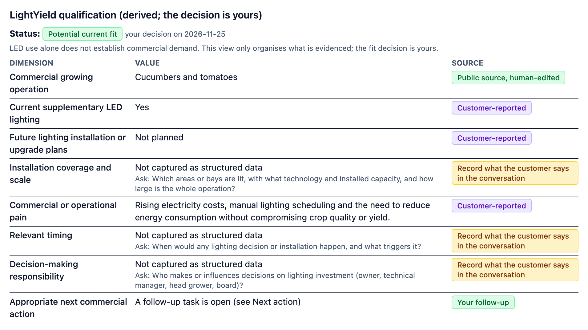
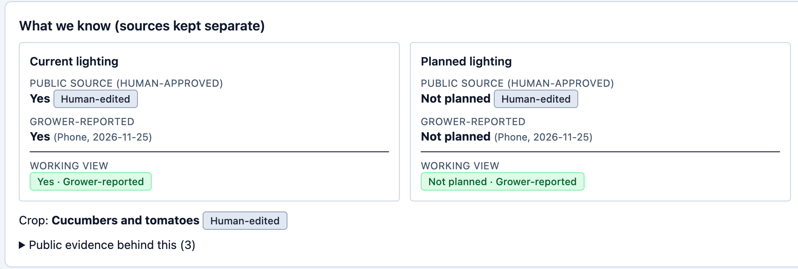
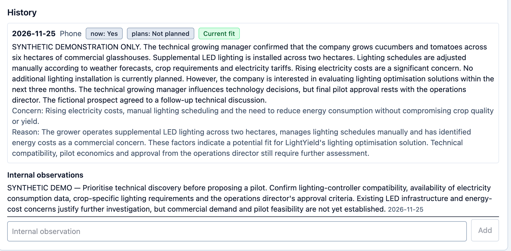

# LightYield Commercial Intelligence

LightYield researches UK glasshouse growers by name and records what their own websites say about crops and supplementary lighting. A person reviews that evidence, qualifies the account and manages discovery questions, a HubSpot record and a tracked follow-up.



## Why it exists

Before a first sales call with a commercial grower, the useful questions are factual: does the grower already run supplementary LED lighting, is an installation planned, how much of the site is lit and who decides? That information is spread across company websites and trade press. General AI answers tend to blend what a source says with what seems likely, and a confident guess can end up as a wrong CRM record.

LightYield keeps those apart. A finding is shown only with a quotation that appears word for word in the retrieved page. Otherwise it stays **Unknown**.

## What it does

- **Research by company name.** Search proposes candidate websites with the evidence for each. You confirm the right one, then the app retrieves a few public pages and extracts crop, current lighting and future plans.
- **Checks extracted source claims.** Deterministic checks verify quotations and screen for negations, past installations, removed systems, plans, conditional wording and statements about other businesses. These checks do not guarantee that every interpretation or human correction is right; the known provenance limitation is documented below.
- **Needs a person to approve.** Each finding is approved, rejected or corrected with a recorded reason. Corrections are labelled as human edits, never as verified sources.
- **Qualifies the account.** Eight dimensions (crop, current LED, plans, coverage, pain, timing, decision-maker, next action) each show where the information came from. You set the fit status. LED use on its own never counts as demand.
- **Prepares discovery.** Questions are generated from what is still unknown, without assuming facts the sources do not show.
- **Records the customer separately.** Conversation notes and fit decisions sit beside public research rather than overwriting it.
- **Syncs to HubSpot.** Approved evidence goes to the company record. Follow-up tasks are created, linked to the company and completed with an outcome.





The screenshots show a fictional company and conversation created for testing.

## Technology

Cloudflare Workers and D1, Workers AI (`@cf/ibm-granite/granite-4.0-h-micro`), Tavily Search, the HubSpot CRM API, React with Vite and Tailwind, GitHub OAuth for sign-in, and Playwright for browser tests.

## Running it locally

You need Node.js, a free Cloudflare account (Workers AI runs on your account) and, optionally, your own Tavily key and HubSpot developer test account.

```sh
npm install
npx wrangler login
cp .dev.vars.example .dev.vars   # add only the keys you want to use
npm run dev:test                 # fictional data, test sign-in, http://localhost:8788
npm run dev:preview              # real research; results are not saved to accounts (needs TAVILY_API_KEY)
```

Each mode starts through a launcher that refuses to run unless the database is local. Run one mode at a time.

Preview mode writes local usage counters, but no company, finding or follow-up records, and cannot sync to HubSpot. Search queries and AI prompts remain subject to the providers' retention terms.

Offline checks: `npm test`, `npm run test:logic`, `npm run test:regress`, and `npm run build && npm run test:ui-offline` (after `npx playwright install chromium`).

## Validation and limits

- Company-name research was tried by hand on several real UK grower websites. The feedback was qualitative: no accuracy rate has been measured.
- The full CRM workflow was completed with a fictional company in a HubSpot developer test account. The follow-up's completion was confirmed in both the local database and HubSpot.
- This is a local MVP. It has not been used with real customers, and no time savings or comparison against other research tools have been measured.

Test results, what this repository leaves out, and known limitations are in [docs/VALIDATION.md](docs/VALIDATION.md).

The code was written with AI assistance (Claude Code) under the author's direction and review. This repository does not include a licence.
